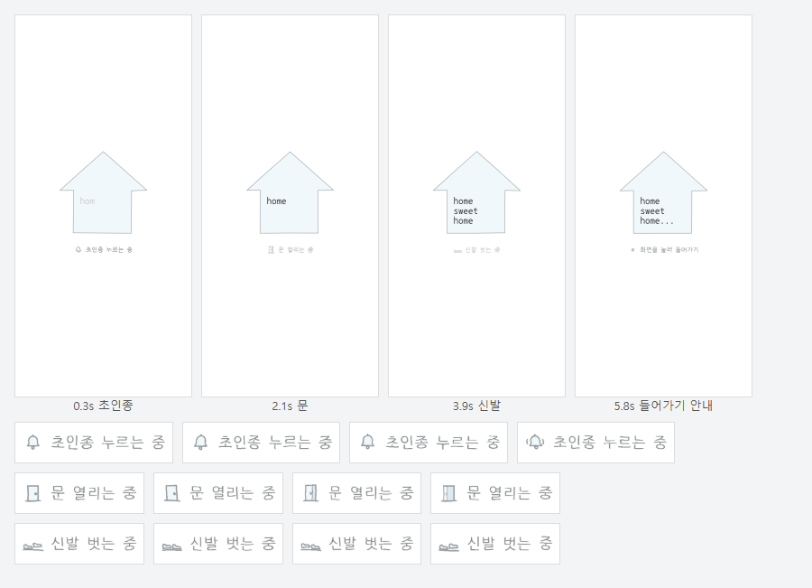

# home sweet home

바이브.me — 로딩 화면 · 평면도 · 방 창. SVG + CSS + ES 모듈, 빌드 · 설치 없음.
글 · 갤러리 · 메모와 관리자는 hongjiwon.love 와 같은 데이터 · 코드를 쓴다(아래).



## 실행

```sh
npm run dev        # node scripts/serve.mjs — 설치할 것 없음
```

- 실제 화면 — http://localhost:5173/
- 데모 도구 — http://localhost:5173/demo.html (다시 재생 · 화면 크기 · 준비 완료 시점)

`?ready=ms` 로 준비 완료 시점을 늦출 수 있다(기본 1200ms).

## 구조

```
index.html              로딩 화면 마크업(SVG 집 + 글자)
src/styles/loader.css   모양 · 위글 · 페이드 · 모션 줄이기
src/loader/typing.js    타이핑 · 지우기 · 반복 — 글자 opacity 만 바꿔 위치 고정
src/loader/status.js    방문 단계(초인종 → 달려나옴 → 문) · 들어가기 안내
src/loader/enter.js     화면 누르기(키보드 Enter 도 받음)
src/loader/ready.js     준비 완료 신호(createReadySignal / demoReady)
src/loader/exit.js      페이드 아웃 후 DOM 제거
src/loader/wobble.js    손그림 위글 — 윤곽 4장 · 글자 기울임을 190ms 마다(필터 없음)
src/loader/index.js     runLoader — 타이핑 + 방문 단계 + 준비 완료 → 안내 → 누르기 → 종료
src/main.js             연결(지금은 데모 신호)
tools/wobble.mjs        윤곽 변형 4장 생성기
```

## 실제 준비 신호로 바꾸기

```js
import { runLoader } from './loader/index.js';
import { createReadySignal } from './loader/ready.js';

const ready = createReadySignal();
runLoader(document.querySelector('.hsh-loader'), { ready: ready.promise });
// …데이터·이미지가 준비되면
ready.resolve();
```

들어가서 로더가 사라지면 `document` 에 `hsh:loader-done` 이벤트가 온다.

## 흐름

1. 집과 글자가 위글거리고 home → sweet → home → `...` 를 한 번 타이핑하고 그대로 둔다(글자는 하나씩 살짝 기울어 흔들린다). 방문 단계가 끝나는 때에 맞춰 천천히 쓰고, 마지막 점은 준비 완료 뒤에 찍는다.
2. 집 아래에 방문 단계가 차례로 뜬다 — 초인종 누르는 중 → (랜덤) 차우연이 뛰어나오는 중 · 홍지원이 걸어나오는 중 → 문 열리는 중. 작은 글도 같은 방식으로 흔들린다.
3. 마지막 점을 찍자마자 `집을 눌러 들어가기`(모바일·데스크톱 같은 문구). 동시에 집 윤곽을 꼭짓점 → 왼쪽 → 아래 → 오른쪽으로 굵은 선이 빠르게 덧그린다(`draw.js`).
4. 집을 누르면(키보드 Enter 도 됨) 글자는 숨고 집이 사용자 쪽으로 다가오며(확대) 평면도로 넘어간다.

- 윤곽: 조금씩 다른 4장을 190ms 씩 번갈아(`wobble.js`). 집 크기·위치는 움직이지 않는다.
- SVG 필터는 쓰지 않는다 — iOS Safari 에서 필터 영역이 검게 깜빡였다.
- 배경: 아이보리(`--hsh-paper`) 위에 회청색 별(`--hsh-pattern`). 새로고침마다 66px 칸마다 하나씩 무작위 위치·기울기.
- 방문 단계 글은 `status.js` 의 `VISIT_STEPS`. 글을 바꾸면 한글 서브셋 폰트도 다시 받아야 한다(아래).
- `prefers-reduced-motion: reduce` — 위글·타이핑·아이콘 모션 없이 완성 상태. 단계 글은 바뀌고 눌러서 들어간다.

## 주소

창마다 고유 주소가 있다(`src/plan/routes.js`). 창을 열거나 창 안에서 옮겨 가면 주소만 바뀐다 — 페이지는 다시 불러오지 않고,
집 배경 · 창 열리는 모양은 그대로다. 직접 들어오기 · 새로고침 · 뒤로/앞으로 모두 주소의 창을 연다. × · 덮개 · Esc 는 홈 `/` 로.

로딩 화면(집 누르기)은 홈 `/` 로 들어올 때만. 창 주소로 들어오거나(새로고침 · 공유 링크 · 로그인에서 보던 창으로 돌아오기)
그 창을 닫아 `/` 로 가도 로딩 화면은 나오지 않는다 — `index.html` 머리 스크립트가 첫 화면 전에 `data-hsh-entry="direct"` 를 달아
로딩 화면을 그리지 않고, 평면도는 다 그려진 채로 깔린다. 글을 받는 동안의 "불러오는 중" 은 창 안에만.
창에서 새로고침한 뒤 닫으면 브라우저가 홈 칸 문서를 새로 불러오는데, 창을 열 때 홈 칸에 남겨 둔 표시(`history.state.hshHome`)로 그때도 로딩 없이.

| 주소 | 화면 |
| --- | --- |
| `/` | 홈(창 없음) |
| `/about` `/teatime` `/notice` `/neighbor` | 방 버튼 창(about __VE · teatime? · notice · neighbor) |
| `/archive` | 열쇠꾸러미(창 대신 흰 화면 — 아래 "archive") |
| `/neighbor/banner` | neighbor 의 '배너교환은 여기에서'(내 배너) |
| `/category/:id` · `/category/:id/folder/:fid` · `/category/:id?page=N` | 글 · 갤러리 · 메모 목록 · 폴더 · 갤러리 쪽(`:id` 는 id 또는 slug) |
| `/category/:id/read` · `/category/:id/folder/:fid/read` | 이어서 읽기 — 그 칸의 글을 목록 순서대로 한 화면에 |
| `/post/:id` · `/post/:id/quote` | 글 · Quote(주인) — hongjiwon.love 와 같은 글 주소 모양 |

- 그 카테고리 버튼이 아직 평면도에 없어도 주소로 열린다(기본 색 창, 제목은 카테고리 이름). 버튼을 붙이면 그 버튼 색 · 이름.
- 볼 수 없는 글(비공개 · 없는 글)은 창 안에 안내만 — 제목 · 내용은 오지 않는다(RLS).
- 음악 · 조명 · 이스터에그(시계 말풍선 · D-day)에는 주소가 없다. 방명록은 아직 없는 화면이라 주소도 없다.
- `/admin/` · `/quote.html` · 정적 파일과 겹치지 않는다. 그 밖의 주소는 홈.
- GitHub Pages: 없는 주소에 `404.html` → `/?route=<주소>` 로 보내고 `index.html` 이 주소(와 새로고침이면 그 칸의 화면)를 되돌린다.
  `index.html` 의 `<base href="/">` 로 상대 주소는 늘 루트 기준. 로컬 `npm run dev` 도 같은 404 처리.
- 이웃 로그인: 복귀 주소는 허용 목록의 `/` 하나, 로그인 전에 보던 주소는 적어 두었다가(sessionStorage) 돌아온 뒤 그 창을 연다.
  관리자는 `/admin/` 그대로.

## archive (열쇠꾸러미)

홈의 archive 버튼 · `/archive` — 브라우저 창 꼴 대신 흰 화면 가운데 3D 열쇠꾸러미. 내 계정 · 사이트 주소 모음.

```
src/archive/links.js     사이트 목록 — 이름 · 주소 · 오브젝트 · 순서(여기만 고친다)
src/archive/shapes.js    열쇠 · 키링 2D 윤곽(둥근 머리 · 하트 머리 · 집 머리 열쇠, 새 · 일기장 · 하트 자물쇠, 천 라벨)
src/archive/keyring.js   three.js 장면 — 손그림 떨림 윤곽을 얇게 뽑은 조각, 고리에 매달린 진자, 끌어 돌리기 · 관성 · 고르기
src/archive/index.js     화면 — ← home · 사이트 버튼 줄 · '이름 ↗' 링크 · 이름표 · 3D 못 쓸 때 목록 · 닫으면 정리
src/styles/archive.css
```

- 사이트 더하기 · 고치기: `links.js` 의 `ARCHIVE_LINKS` 한 줄. `url` 이 비어 있으면 열쇠 · 이름은 보이되 밖으로 나가지 않는다(링크 비활성 · "준비 중").
  다른 갠홈은 `object: 'house'` 줄을 더 붙이면 열쇠가 하나씩 늘어난다(색은 은색 · 버터색, 창 색은 하늘 · 연보라 · 버터를 번갈아).
- 조작: 끌면 꾸러미가 돌고(위아래는 조금) 놓으면 관성으로 돌다 멈춘다. 열쇠마다 고리의 한 점에 매달린 진자라 따로 흔들리고,
  각도는 한도 안이라 떨어지거나 화면 밖으로 날아가지 않는다. 열쇠 한 번 → 고리를 타고 맨 앞으로 나오며 이름표, 아래에 '이름 ↗'.
  같은 열쇠를 또 누르거나 링크 → 새 탭. 다른 열쇠 → 선택 바뀜, 빈 곳 → 풀림, 5px(손가락 10px) 넘게 끌면 누름이 아니다.
  아래 버튼 줄로도 고른다(키보드 Tab · ← → · Enter). Esc 는 선택 풀기 → 한 번 더 누르면 홈.
- 손그림: 윤곽은 짙은 회색(`#55595d`, 평면도 선보다 한 단 짙게), 굵기가 조금씩 다르고 3장이 190ms 마다 바뀐다(평면도 위글과 같은 박자).
  색은 툰 3단 그늘뿐 — 금속 반짝임 없음. 라벨 글씨는 로딩 화면 글꼴(Nanum Gothic Coding).
- three.js(`three@0.169.0`)는 jsDelivr 에서 archive 를 열 때만 받는다 — 홈 첫 화면 무게는 그대로. WebGL 이 없거나 못 받으면 같은 데이터로 목록.
- 모션 줄이기: 저절로 흔들림 · 위글 · 관성 없이(손으로 돌리기 · 고르기는 그대로). archive 를 벗어나면 그리기를 멈추고 WebGL 자원 · 캔버스를 정리한다.

## 글 · 갤러리 · 메모 (hongjiwon.love 연동)

hongjiwon.love 와 **같은 Supabase 원본**을 그대로 읽는다(복사본 없음 — 그쪽에서 쓰고 · 고치고 · 지우면 바로 보인다).
본문 렌더러 · Quote Preset 규칙 · 관리자 화면은 hongjiwon.love 의 파일을 **같은 배포 판으로 실시간으로 불러 쓴다**
(`src/content/remote.js` — 그쪽 `core/build-version.js` 를 먼저 읽고 같은 `?v=` 로). 서식을 이 저장소에 다시 적지 않는다.

```
src/content/remote.js         그쪽 파일 불러오기(같은 판) · ?content-origin=http://localhost:8788 (로컬에서만)
src/content/supabase.js       클라이언트 하나(neighbor · 글 창 · 관리자) — 공개 키만, 권한은 DB(RLS · RPC)
src/content/data.js           조회 — 카테고리 · 폴더 트리 · 갤러리 페이지 · 글 · 비밀글/폴더 비밀번호(그쪽과 같은 쿼리 · 정렬)
src/content/render.js         본문 — 그쪽 renderPostDetailBody 와 같은 길(프리셋 → renderStyledPostContentInto → 글자 크기 ±)
src/content/images.js         본문 · 갤러리 사진 — 그쪽 /api/post-cover(잠긴 사진은 머리글로 표를 실어 fetch)
src/content/viewer.js         창 안쪽 — 목록(log) · 쪽지(memo) · 폴라로이드(gallery) · 글 · 비밀번호 칸
src/content/home-settings.js  Settings > Home(바이브.me 전용 키) → 탭 제목 · 파비콘 · 커서
src/styles/content.css        창 안쪽 모양(본문 안은 건드리지 않는다)
admin/index.html              관리자 — 그쪽 /admin/ 같은 판을 받아 띄운다(src/admin/shell.js)
```

### 평면도 버튼에 연결하기

버튼(`.hsh-sticker`)에 `data-category` 를 달면 그 카테고리 창이 열린다. 값은 카테고리 **id 또는 slug**
(이름은 관리자에서 바뀔 수 있어 쓰지 않는다). 지금 카테고리: LOG `1`(slug `still`) · PIC `2`(`with`, gallery) · MEMO `3`(`you`).
`data-look` 은 모양 — `log`(목록) · `memo`(쪽지) · `gallery`(사진 칸), 비우면 카테고리 유형대로.
`tools/floorplan.mjs` 의 `tag()` 마지막 칸으로 준다:

```js
tag('e', 'log', '기록', 712, 1180, '#cfe0fb', '#8a62dc', 3, { category: 1 });
tag('kitchen', 'memo', '메모', 662, 462, '#fbd5e3', '#4a98e4', 3, { category: 3, look: 'memo' });
tag('living', 'pic', '사진', 582, 726, '#fbefae', '#e8893a', -2, { category: 2 });
```

`node tools/floorplan.mjs` 로 `src/plan/floorplan.svg` 를 다시 만든다. 버튼이 아닌 곳에서 열려면
`.hsh-plan` 에 `hsh:room` 이벤트(detail `{ room, label, name, bg, fg, category, look }`)를 보낸다.

- 목록 → 폴더 → 글로 갈 때마다 창 기록이 한 칸씩 쌓인다(< > · 휴대폰 뒤로 가기). 목록으로 돌아오면 스크롤 자리 그대로.
- 공개 범위는 DB 가 정한다 — 비공개 글 · 나만 보기 폴더는 방문자에게 오지 않고, 비밀글 · 비밀번호 폴더는 칸에 비밀번호를 넣어야 열린다.
- HTML 모드 글은 shadow root 안에 그린다(글 안 `<style>` 이 홈 화면에 번지지 않게) — 화면보다 넓으면 그쪽과 같은 계산으로 줄인다.
- 글쓰기 · 고치기 · 지우기는 hongjiwon.love 에서(주인에게는 글 아래 링크).

### Quote(주인만)

글 머리의 `quote` → 발췌 구간 고르기 → `미리보기 →` 로 창 안에 Quote 화면이 열린다(copy · export).

- 구간: `시작점` · `끝점` 을 누르고 본문에서 그 자리를 탭한다(단어 · 대사 · 지문 단위로 맞춘다). 고르지 않으면 글 전체 — 그쪽 에디터 발췌와 같다.
  그려진 본문의 두 점 → 원본 HTML 구간은 그쪽 공용 파일 `posts/preview/posts-excerpt-range.js`(그쪽 배포 전이면 글 전체만).
- Quote 화면 = `quote.html`(같은 출처 iframe, `src/quote/studio.js`). 그쪽 `index.html` 의 CSS · posts 스크립트 · `posts/posts` 마크업을
  같은 판으로 깔고, 그쪽 에디터가 글을 열 때와 같은 함수(`setRichEditorContent` → `prepareEditorUI` → `applyPostPresetById` → `openEditorPreview`)를 부른다.
  페이지 나누기 · 프리셋 · 배경 · 사진 굳히기 · html2canvas 캡처 · 파일 이름이 그쪽과 같다. 조작 칸 모양만 `src/styles/quote.css`.
  iframe 인 까닭: 그쪽 에디터 스크립트가 선언하는 전역 이름이 글 창이 쓰는 이름과 겹친다.
- 저장(save) · 임시저장은 부르지 않는다. HTML 모드 글은 디자인 한 장(그쪽과 같다).

## 확인(E2E)

```sh
npm run e2e                     # node tests/e2e.mjs — 이웃 web 저장소(WEB_DIR, 기본 ../web)가 있어야 한다
npm run e2e -- --only=owner     # visitor · owner · admin · routing · mobile · layout · archive (--browser=webkit)
```

web 저장소의 `tests/lib/harness.mjs`(Playwright · 정적 서버)와 `mock-supabase.mjs`(RLS 흉내 메모리 DB)를 쓴다 —
**운영 DB 에 닿지 않는다.** web 작업 트리를 "hongjiwon.love" 로 띄우고 그쪽 `functions/api/post-cover.js` · `ops/[[path]].js`
실제 코드를 돌린다. 방문자(잠금 폴더 · 비밀글 · 사진 표) · 주인(비공개 사진 · 부분 발췌 · export PNG 크기 · 사용 중 프리셋 바꾸기) ·
관리자(주인/다른 계정/로그아웃 · Home 저장과 새로고침 · Category · Quote Preset 이 두 사이트에 반영 · Dashboard) · 휴대폰.
Google 로그인 자체는 흉내 세션이다 — 실제 로그인은 배포 뒤에 확인한다.

### 관리자 `/admin/`

SETTINGS(HOME · CATEGORY) · QUOTE PRESET · DASHBOARD. 로그인은 Google(같은 계정), 주인 계정이 아니면 화면을 닫는다.
저장 버튼마다 옆에 적용 범위가 붙는다 — `바이브.me 에만`(HOME) · `두 사이트 함께`(CATEGORY · QUOTE PRESET 저장 · 사용 중 지정) ·
`hongjiwon.love 통계`(DASHBOARD). 글 창의 글자 크기 ± 는 주인이 누르면 두 사이트 방문자 기본값이 된다(`기본값 · 두 사이트`).

- HOME — 키 `vibe_site_title` · `vibe_site_favicon_url` · `vibe_site_cursor`(같은 `site_settings` 표, hongjiwon.love 값과 따로).
- CATEGORY · QUOTE PRESET — hongjiwon.love 와 **같은 데이터**. 바꾸면 두 사이트에 같이 반영된다.
- DASHBOARD — hongjiwon.love `/api/ops`(그쪽이 이 출처에만 CORS 를 연다). 통계는 hongjiwon.love 방문 기준.

## 폰트

Nanum Gothic Coding (SIL Open Font License 1.1). `src/fonts/` 에 라틴 서브셋과, 방문 단계 글에 쓰는 한글만 담은 서브셋이 있다.
한글 서브셋은 Google Fonts `css2?family=Nanum+Gothic+Coding&text=<쓰는 글자>` 의 woff2 를 받아 `nanum-gothic-coding-status.woff2` 로 바꾼다.
